[English](https://ht32-holtek.github.io/ht32-vscode/) | [繁體中文](https://ht32-holtek.github.io/ht32-vscode/README_TRAD) | [简体中文](https://ht32-holtek.github.io/ht32-vscode/README_SIMP)

# Holtek HT32 VS Code Extension

Holtek HT32 系列 Cortex-M 微控制器（M0+/M3/M4）专用 VS Code 扩展。支持导入 Keil uVision 与 HT32-IDE 项目，或从头创建新项目，并通过 **pyOCD**（默认）或内置 OpenOCD 实现一键编译、烧录与调试。

---

<br>

## 功能简介

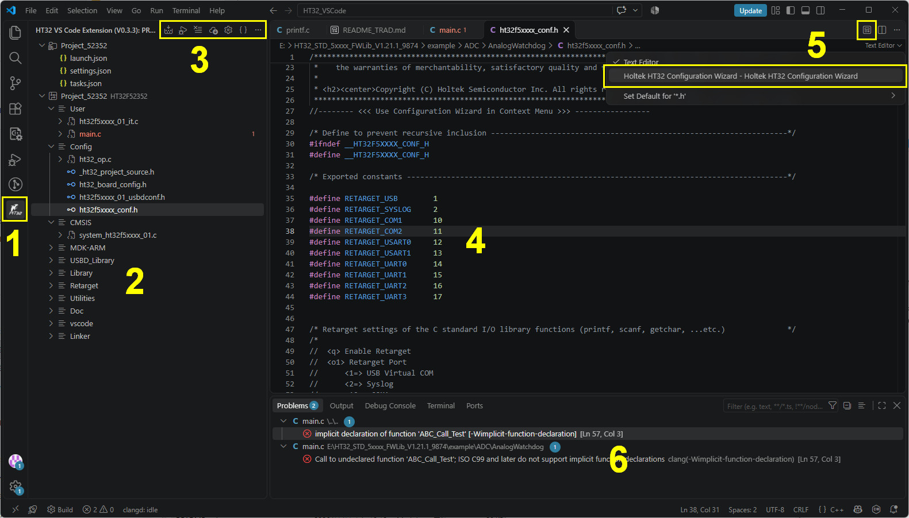

| # | 区域 | 说明 |
|---|------|------|
| **1** | HT32 活动栏图标 | 点击打开 HT32 面板 |
| **2** | 项目文件树 | 源代码组：右键可添加/移除文件与组 |
| **3** | 工具栏 | 快速操作按钮：**Build**、**Clean**、**Download**、**Debug**、**Settings** 等<br>工具栏最右侧的 **`···`（更多操作）** 按钮内含 **Open Project**、**Close Project** 与 **Create Project** |
| **4** | 编辑器 | 主代码编辑区：显示任何打开中的源文件 |
| **5** | Configuration Wizard 控件 | 打开含有 Configuration Wizard 语法的文件时出现于右上角<br>**预览图标**：可直接打开可视化向导<br>**Text Editor ▼** 下拉菜单：可切换文字编辑器与向导视图 |
| **6** | 底部面板 | **Problems**：编译错误与警告<br>**Output**：扩展与调试器 log<br>**Debug Console**：调试输出<br>**Terminal**：Make 编译的原始输出 |

---

<br>

## 功能特色

| 功能 | 说明 |
|------|------|
| **创建新项目** | 向导式项目生成器，支持 HT32 FWLib（标准系列与 49x 系列） |
| **导入 uVision** | 导入 Keil `.uvprojx` / `.uvmpw` 项目，自动生成 Makefile、链接脚本、clangd 设置 |
| **导入 HT32-IDE** | 导入一个或多个 Eclipse CDT `.project`/`.cproject` 项目文件夹 |
| **编译 / 清除** | 一键或工具栏按钮；支持复合式 Post-Build 任务 |
| **调试** | Cortex-Debug + pyOCD（默认）或内置 OpenOCD；支持 Flash & Debug 或 Attach 模式 |
| **烧录** | 通过 pyOCD 或内置 OpenOCD 烧录固件；支持 CMSIS-DAP（e-Link32）、J-Link、ST-Link |
| **项目设置** | 提供编译器标志、调试接口、Post-Build 命令的 WebView 设置面板 |
| **项目文件树** | 源代码组视图，支持添加/移除文件与组 |
| **设置向导** | HT32 配置文件可视化编辑器（`conf.h`、`usbdconf.h`、`startup.s`），兼容 Keil 向导语法 |
| **Code Intelligence (clangd)** | 自动生成 `.clangd` 与各项目独立的 `compile_commands.json` |

---

<br>

## 安装需求

| 项目 | 说明 |
|------|------|
| 操作系统 | Windows x64 |
| VS Code | 1.106.3 以上 |
| 调试器 | Holtek e-Link32 Pro / Lite；支持 J-Link、ST-Link |
| FWLib | 需要 |

> **OpenOCD**：已内置<br>
> **pyOCD**：首次使用时自动安装<br>
> **GCC 工具链**：扩展启动时自动检测；找不到时通过 winget 自动安装（**需 GCC 8 以上**）<br>
> **依赖扩展**：安装时自动一并安装 **Cortex-Debug**（调试接口）与 **Holtek HT32 Configuration Wizard**（[设置向导](https://marketplace.visualstudio.com/items?itemName=holtek.ht32-config-vscode)）。

> 💡 **提示：** 当 VS Code 在**右下角**弹出通知询问是否安装缺少的组件（扩展、GCC 工具链、pyOCD），请点选 **Install**。

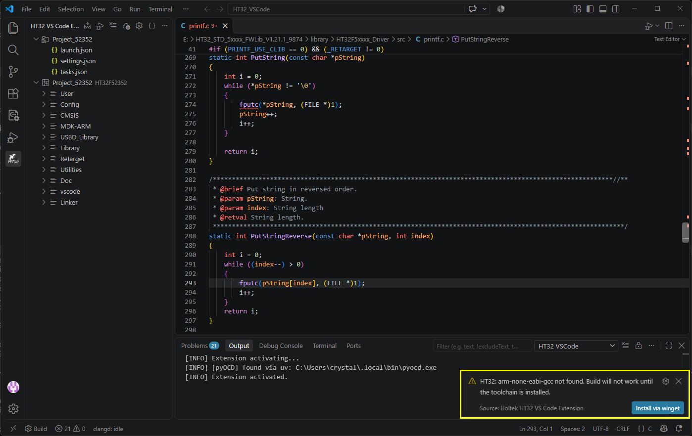

---

<br>

## 安装扩展

**方法一：从 .vsix 安装**

1. VS Code → 扩展 → `...` → **Install from VSIX...**
2. 选取 `ht32-vscode-x.x.x.vsix`

> **注意：** VS Code 会自动从 Marketplace 寻找并安装扩展的依赖包。
> 若依赖包尚未发布至 Marketplace，安装将会失败。

<table><tr>
<td>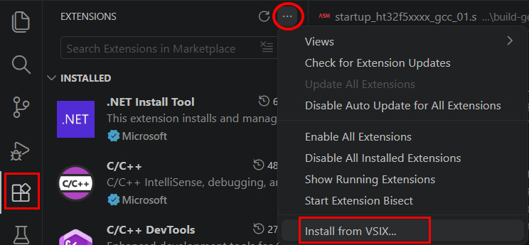</td>
<td>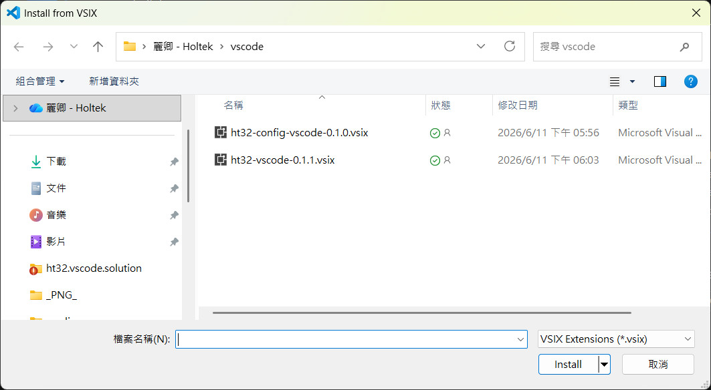</td>
</tr></table>

---

<br>

**方法二：从 Marketplace 安装**

1. 扩展搜索栏输入 `Holtek HT32 VS Code Extension`（或直接搜索 `holtek` / `ht32` 即可找到）
2. 点击 **Install**

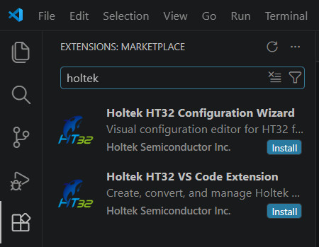

---

<br>

## 界面介绍

安装后，左侧**活动栏**出现 **HT32 图标**，点击展开 HT32 面板。

**项目未打开时**，主画面依次显示创建与打开项目的按钮、查看说明文档的链接、转换 uVision 与 HT32-IDE 项目的按钮，以及在线更新扩展、从 VSIX 安装、在线更新 Device Packs 与从文件安装 Pack 的快速入口。若曾打开过项目，下方会列出最近打开列表，点击即可直接打开。

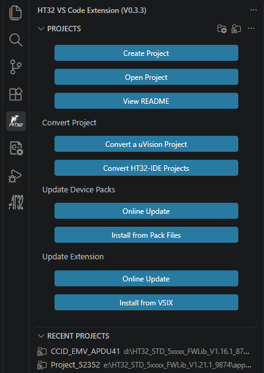

---

<br>

**工具栏按钮（项目加载后显示）：**

| 按钮 | 功能 |
|------|------|
| Build | 编译 |
| Debug | 通过 pyOCD 或 OpenOCD 启动 Cortex-Debug 调试（Flash & Debug 或 Attach 模式） |
| Clean | 删除 `build/` 输出目录 |
| Download | 烧录固件（不启动调试） |
| Erase Flash | 清除整颗芯片的 Flash（chip erase） |
| Settings | 打开项目设置 |
| Generate Build & Debug Config | 重新生成 `tasks.json` 与 `launch.json` |

**`···`（更多操作）** 菜单另外包含：

| 项目 | 功能 |
|------|------|
| Create Project | 打开创建项目向导 |
| Open Project | 打开 `.ht32vs` 项目文件 |
| Close Project | 关闭当前加载的项目 |

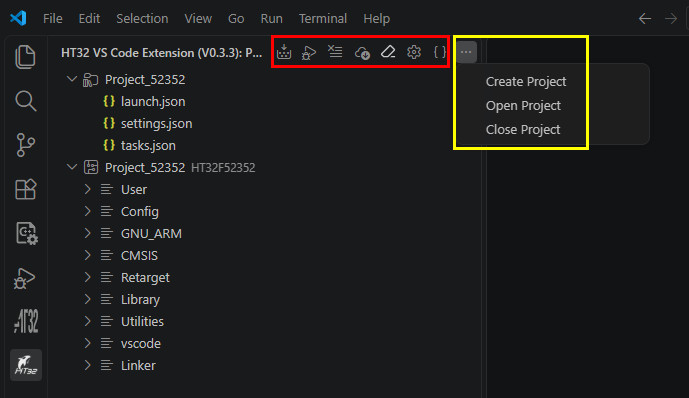

---

<br>

**项目文件树**显示源代码组结构，方便管理项目文件。

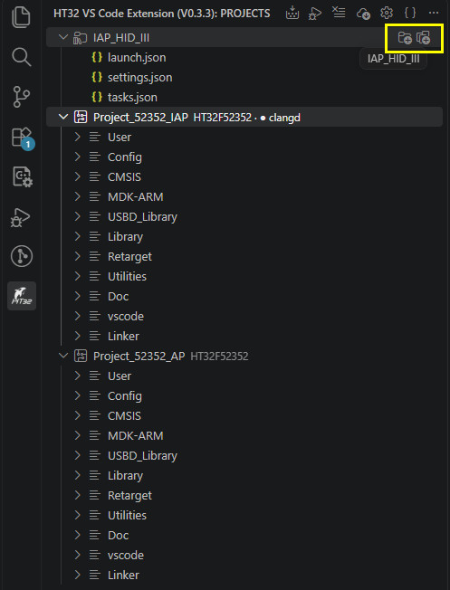<br>

将鼠标移至根节点即可显示两个按钮：**Add New Project** 与 **Add Existing Project**：

| 按钮 | 功能 |
|------|------|
| **Add New Project** | 执行向导，在同一文件夹创建新子项目 |
| **Add Existing Project** | 从同一文件夹选取已转换或创建的项目 |

<br>

## 右键菜单

| 对象 | 操作 |
|------|------|
| 树状根节点（`.ht32vs`） | Rename Project File（重命名）|
| 子项目节点 | Move Up（上移）、Move Down（下移）、Open Folder in Explorer（打开项目文件夹）、Remove Project（从列表移除）、Add Group（添加组） |
| 组 | Add New Files（新建文件）、Add Existing Files（加入现有文件）、Add Group（在此组下添加子组）、Remove / Delete...（移除或删除） |
| 组文件夹 | Add New Files（新建文件）、Add Existing Files（加入现有文件）、Add Group（在此组下添加子组）、Remove / Delete...（移除或删除） |
| 文件 | File Settings（排除编译 / Execute-only / ROM region）、Remove / Delete...（移除或从磁盘删除） |
| Linker 文件（`.ld`） | Remove / Delete...（移除或从磁盘删除） |

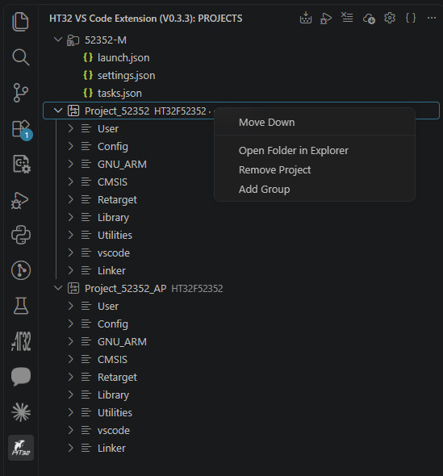<br>
---

<br>

## 项目文件（.ht32vs）

每个 HT32 项目都会对应一个 **`.ht32vs` 项目文件**（保存在 `HT32_VSCode/` 内）。此文件记录此项目包含哪些子项目目录，在转换或创建项目后自动生成。

### 打开项目

| 方式 | 说明 |
|------|------|
| **双击 `.ht32vs`** | 在文件管理器双击 `.ht32vs` 文件，直接打开项目 |
| **Open Project** | 通过欢迎画面的 **Open** 按钮、`···` 菜单或 `HT32: Open Project` 命令浏览并打开 `.ht32vs` 项目文件 |
| **Recent Projects** | 点击最近打开列表中的任一项目（项目未打开时显示） |

### 管理子项目

一个 `.ht32vs` 可包含多个子项目目录（例如 `Project_IAP` 与 `Project_AP`），可随时添加或移除。所有子项目必须位于**同一个 `HT32_VSCode/` 文件夹**下。

| 操作 | 方式 |
|------|------|
| **添加子项目（新建）** | 将鼠标移至根节点 → **Add New Project** — 执行创建项目向导，添加子项目。向导中的**项目文件夹**固定为当前已打开的项目文件夹，无法更改。 |
| **添加子项目（现有）** | 将鼠标移至根节点 → **Add Existing Project** — 从同一文件夹中选取已转换或创建的项目 |
| **移除子项目** | 在项目节点右键 → **Remove Project**，从列表中移除（磁盘上的文件不会删除）。仅剩一个子项目时无法执行。 |
| **上移 / 下移** | 在项目节点右键 → **Move Up** 或 **Move Down**，调整子项目在 **Build All** 时的编译顺序。 |

当前只有**一个**子项目，添加第二个时将提示输入**多项目文件名**（默认为项目根目录名称）。确认后生成：

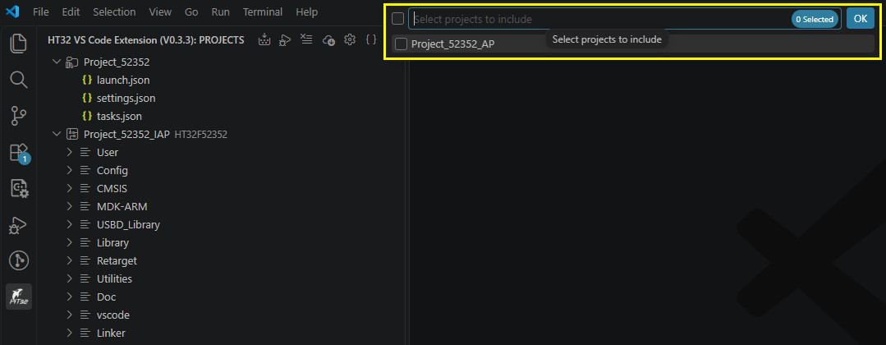<br>
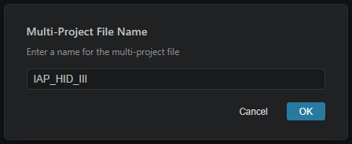<br>

| 文件 | 内容 | 说明 |
|------|------|------|
| `ProjectA.ht32vs` | `{ "projects": ["ProjectA"] }` | 仅包含 ProjectA 的单一项目文件 |
| `ProjectB.ht32vs` | `{ "projects": ["ProjectB"] }` | 仅包含 ProjectB 的单一项目文件 |
| `MyProject.ht32vs` | `{ "projects": ["ProjectA", "ProjectB"] }` | 包含两个子项目的多项目文件 |

#### 目录结构

```
MyProject/
└── HT32_VSCode/
    ├── ProjectA.ht32vs          ← 单一项目视图
    ├── ProjectB.ht32vs          ← 单一项目视图
    ├── MyProject.ht32vs         ← 多项目视图（使用中）
    ├── ProjectA/
    │   ├── Makefile
    │   └── ...
    └── ProjectB/
        ├── Makefile
        └── ...
```

---

<br>

## 创建新项目

> 使用前请先从 Holtek 官网下载并准备好 HT32 FWLib。

1. HT32 面板 → **Create Project**
2. 按向导步骤选择：

| 步骤 | 内容 |
|------|------|
| ① | 选择 **HT32 FWLib 根目录** |
| ② | 选择 **MCU 型号** |
| ③ | 选择输出类型：**Executable (.elf)** 或 **Library (.a)** |
| ④ | 输入**项目名称**和保存位置 |

> **Library (.a)：** 生成静态库而非可执行文件。创建后只有一个空的 `.c` 文件作为起点——加入你的源代码并实现库内容即可。

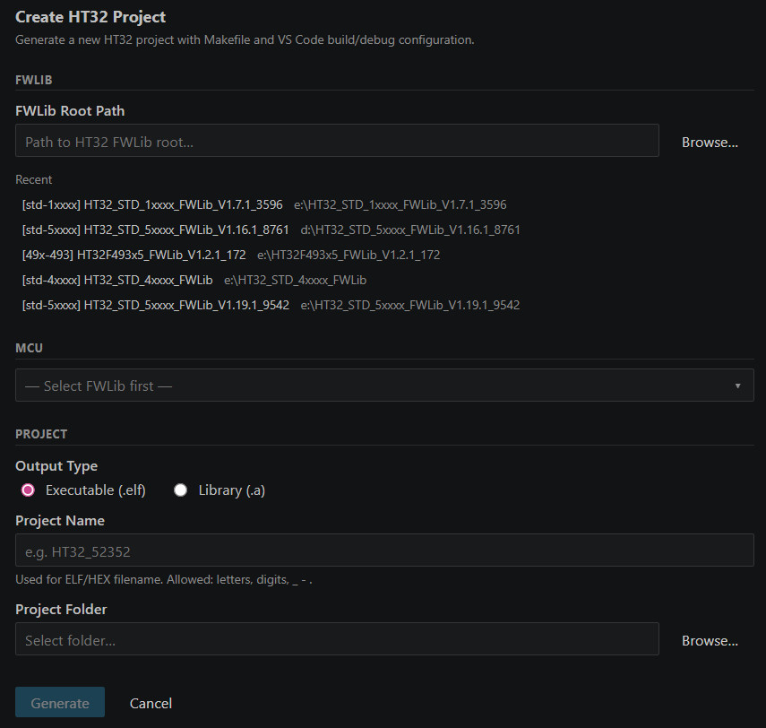

<br>

**目录结构**

```
MyProject/                 ← 用户命名的项目文件夹
├── .clangd                ← 打开项目时自动生成（clangd 设置）
└── HT32_VSCode/           ← VS Code workspace root
    ├── .vscode/
    │   ├── tasks.json
    │   ├── launch.json
    │   └── settings.json
    ├── <projectName>.ht32vs
    └── <projectName>/     ← 名称来自向导中输入的项目名称
        ├── Makefile
        ├── sources.list
        ├── compile_commands.json
        ├── *.json
        ├── src/           ← 用户源代码
        │   ├── main.c
        │   ├── ht32fxxxx_it.c
        │   ├── system_ht32fxxxx.c
        │   ├── ht32fxxxx_conf.h
        │   └── ht32_op.c
        └── GNU_ARM/       ← 自动生成的 GCC 支持文件
            ├── startup_ht32fxxxx_gcc_xx.s
            ├── linker.ld
            ├── syscalls.c
            └── ht32_stack_analysis.c
```

> **注意：工作区信任** — 若 VS Code 以受限模式打开文件夹，将显示通知：*「You are in Restricted Mode」*，请点选 **Trust** 以启用编译与调试功能。

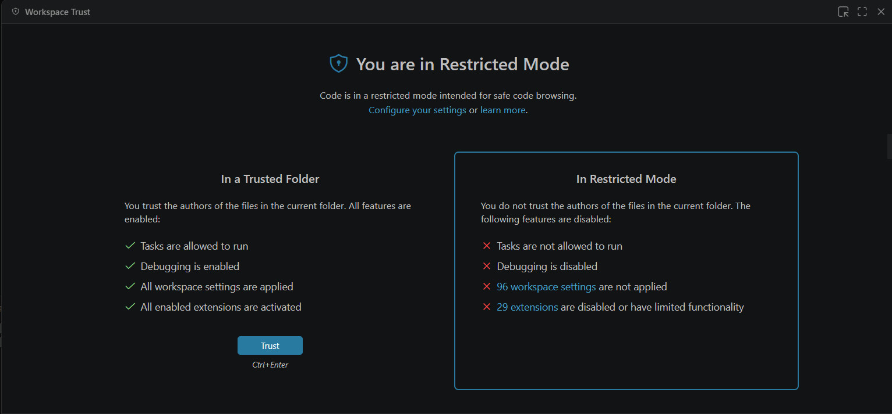

---

<br>

## 导入 Keil uVision 项目

1. HT32 面板 → **Convert uVision Project**
2. 选取 `.uvprojx`（单一项目）或 `.uvmpw`（多项目）

`.uvmpw` 可**一次转换所有子项目**，每个子项目各生成一个独立的目录，目录名称即为 `.uvprojx` 的文件名。

**自动生成：**

- `Makefile`、链接脚本（`.ld`）、`startup_xxx_gcc.s`（共用文件位于 `GNU_ARM/`）
- `compile_commands.json`、`tasks.json`、`launch.json`、`settings.json`

**`.uvprojx` 单一项目** — 共用文件输出至 `HT32_VSCode/GNU_ARM/`；Makefile 与元数据输出至 `HT32_VSCode/Project/`

**`.uvmpw` 多项目** — 每个子项目各一个目录，目录名称取自 `.uvprojx` 文件名（例如 `Project_IAP.uvprojx` + `Project_AP.uvprojx`）：

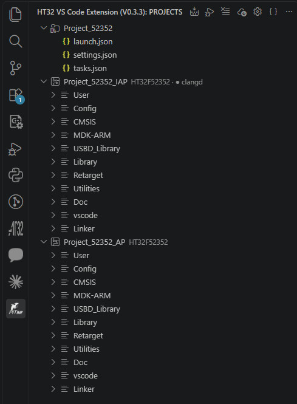

```
<ProjectRoot>/
├── MDK_ARMv5/             ← 原始 Keil 项目
└── HT32_VSCode/           ← VS Code workspace root
    ├── .vscode/
    │   ├── tasks.json
    │   ├── launch.json
    │   └── settings.json
    ├── GNU_ARM/           ← 共用：startup .s、链接脚本、ht32_op.c、syscalls.c、ht32_stack_analysis.c
    ├── Project_IAP/       ← 取自 uvprojx 文件名
    │   ├── Makefile
    │   ├── compile_commands.json
    │   └── *.json
    └── Project_AP/
        ├── Makefile
        ├── compile_commands.json
        └── *.json
```

---

<br>

**转换警告**（如 Keil 预编译 `.lib` 无法用于 GCC 工具链）会显示在 VS Code **问题（Problems）**面板中。

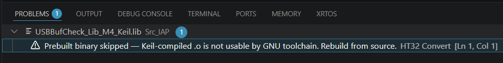

> **工作区信任** — 若 VS Code 以受限模式打开文件夹，扩展将显示通知：*「This workspace is in Restricted Mode. Please trust the workspace to enable all features.」*，请点选 **Trust Workspace** 以启用编译与调试功能。

---

<br>

## 导入 HT32-IDE 项目

1. HT32 面板 → **Convert HT32-IDE Projects**
2. 选取一个或多个包含 `.project` / `.cproject` 的**项目文件夹**

每个选取的文件夹各自转换为 `HT32_VSCode/` 内的独立目录，共用 `HT32_VSCode/GNU_ARM/` 存放 startup、链接脚本与自动生成的 C 文件。生成的目录结构及**项目树**组织方式，与导入 uVision 项目相同。

> **工作区信任** — 若 VS Code 以受限模式打开文件夹，扩展将显示通知：*「This workspace is in Restricted Mode. Please trust the workspace to enable all features.」*，请点选 **Trust Workspace** 以启用编译与调试功能。

---

<br>

## 构建

- 点击工具栏的 **Build**
- 或按 `Ctrl+Shift+B`（直接执行默认构建任务 **Build (make)**）

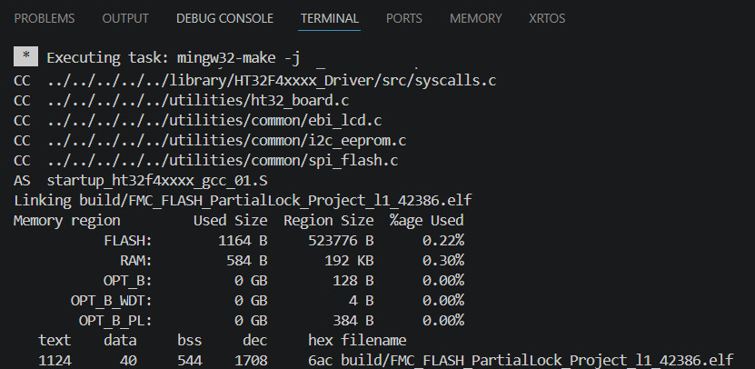

多项目时，工具栏的 **Build**、**Debug**、**Clean**、**Download** 按钮会弹出**快速选取列表**让用户选择要操作哪个子项目。**Build** 与 **Clean** 另有 **Build All** / **Clean All** 选项，可依次处理所有子项目。编译顺序与**项目树**的排列顺序相同，可在项目节点上右键 **Move Up / Move Down** 调整。

<br>

也可在「项目设置」中设置 **Post-Build** 命令，Build 成功后自动执行（例如 CRC 计算）。Post-Build 命令的工作目录为 `HT32_VSCode/`（`${workspaceFolder}`）。

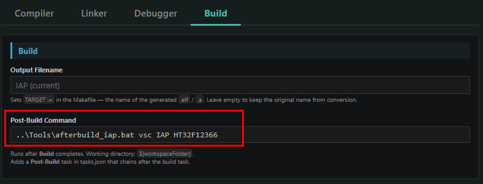

---

<br>

## 清除

- 点击工具栏的 **Clean**，或按 **Ctrl+Alt+C**
- 删除 `HT32_VSCode/Project/build/`（或 `HT32_VSCode/Project_xxx/build/`）目录下所有编译输出

---

<br>

## 烧录与调试

> **Cortex-Debug** 为依赖包，安装本扩展时会自动一并安装。

烧录（Download）与调试（Debug）皆通过同一**调试服务器**执行，可在**设置 → Debugger → Debug Server** 切换：

| 调试服务器 | 说明 |
|-----------|------|
| **PyOCD**（默认） | 免安装驱动；首次使用时自动安装 |
| **OpenOCD** | 已内置；可作为备选方案 |

> 若使用 J-Link 搭配 OpenOCD，Windows 需将驱动更换为 WinUSB；搭配 pyOCD 则保留原厂驱动即可。

所有相关设置详见「[项目设置 → Debugger 选项卡](#debugger-选项卡)」。

### 烧录固件（Download）

> 需要连接支持的调试器（CMSIS-DAP / J-Link / ST-Link）

1. 确认调试器已连接并驱动正常
2. 点击工具栏的 **Download**，或按 **Ctrl+Alt+D**
3. 固件自动烧录，终端显示进度

### 清除 Flash（Erase Flash）

清除整颗芯片的 Flash，不烧录新固件。适用于现有固件损坏或需要完全清除的情况。

1. 确认调试器已连接
2. 点击工具栏的 **Erase Flash**

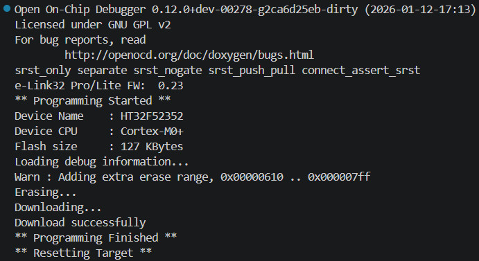

### 调试（Debug）

1. 点击工具栏的 **Debug**
2. 自动编译、烧录，并开始调试

### Attach（附接到运行中的目标）

适用于目标板已经在运行（不需要重新烧录）的情况，例如观察特定状态下的程序行为。

1. 确认目标板已上电并运行
2. 按 **F5** 或打开**运行和调试**（Ctrl+Shift+D）
3. 从下拉菜单选择 **HT32 PyOCD Attach**（或 **HT32 OpenOCD Attach**）

> Attach 不会编译也不会烧录，直接附接到运行中的目标，不会重置目标。

| 模式 | 说明 |
|------|------|
| HT32 PyOCD Debug | 编译→烧录→启动调试 |
| HT32 PyOCD Attach | 不烧录，直接附接到运行中的目标 |
| HT32 OpenOCD Debug | 编译→烧录→启动调试 |
| HT32 OpenOCD Attach | 不烧录，直接附接到运行中的目标 |

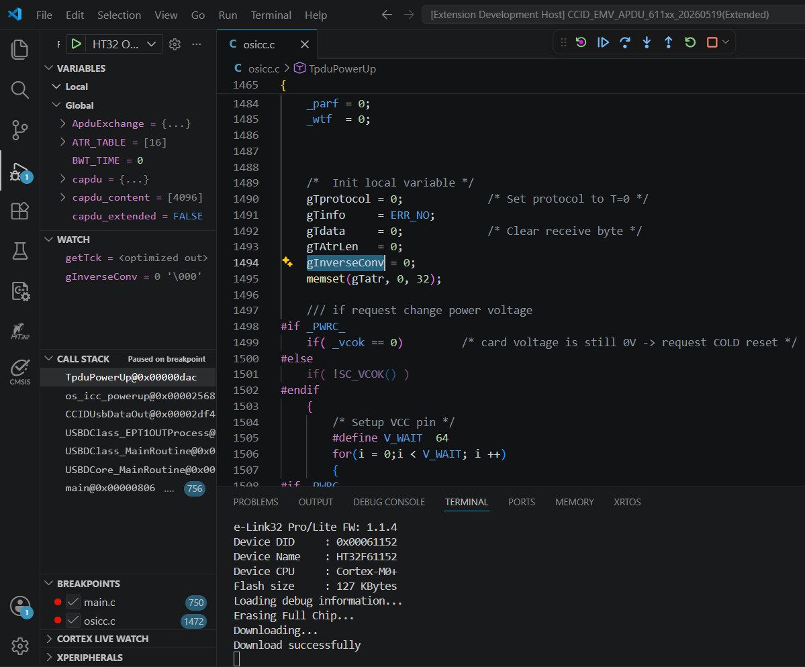

---

<br>

## Cortex-Debug 操作说明

Cortex-Debug 是本扩充功能的调试接口，负责提供中断点管理、变量观察、内存窗口与外设寄存器查看等功能。

### 调试工具栏

调试启动后，画面上方出现浮动工具栏：

| 按钮 | 快捷键 | 说明 |
|------|--------|------|
| Continue / Pause（继续／暂停） | F5 | 程序暂停时显示 Continue（继续执行至下一中断点）；运行中时显示 Pause（手动暂停），**同一按钮切换** |
| Step Over（不进入） | F10 | 执行下一行，不进入调用的函数内部 |
| Step Into（进入） | F11 | 进入下一个函数内部 |
| Step Out（跳出） | Shift+F11 | 跳出当前函数，返回调用端 |
| Restart（重新开始） | — | 重新烧录并从头开始调试 |
| Stop（停止） | Shift+F5 | 停止调试会话 |

---

### 中断点（Breakpoints）

- 在程序代码行号左侧**点一下**，出现红点即为设定中断点；再点一下取消
- **条件中断点**：在红点上按右键 → **Edit Breakpoint**，可输入触发条件（例如 `i == 10`）

---

### 变量观察（Watch）

左侧**运行和调试**面板的 **WATCH** 区块可监视任意表达式：

1. 点击「**＋**」
2. 输入变量名称或 C 表达式（例如 `myVar`、`buf[0]`、`*(uint32_t*)0x20000000`）
3. 每次调试器暂停时自动更新数值

---

### 内存窗口（Memory View）

在 **MEMORY** 面板点击「**＋**」新增内存窗口，需依序完成**两步输入**：

| 步骤 | 弹出窗口说明 | 输入内容 | 范例 |
|------|------------|---------|------|
| ① | 起始地址（Enter address to watch） | 要监视的内存起始地址（hex） | `0x20000000` |
| ② | 显示长度（Enter a hex/dec constant or a C-expression for size） | 要显示的 byte 数量 | `256`、`0x100`、`sizeof(myBuf)` |

> **注意：** 第二个弹出窗口询问的是**显示长度**（要显示几个 byte），并非第二个地址。  
> 长度可输入十进制（`256`）、十六进制（`0x100`），或 C 表达式（`sizeof(myBuf)`、`MY_BUF_SIZE`）——Cortex-Debug 会透过调试器求值后决定显示范围。

**切换显示格式：** Memory View 上方工具栏可切换数据宽度

| 按钮 | 格式 | 说明 |
|------|------|------|
| `1` | Byte | 每格 8-bit |
| `2` | HWord | 每格 16-bit |
| `4` | Word | 每格 32-bit |
| `8` | DWord | 每格 64-bit |

**删除内存窗口：** 点击 Memory View 标题旁的 **×** 即可移除。

---

### 外设寄存器（Peripherals）

左侧面板的 **PERIPHERALS** 依据 SVD 文件列出所有 MCU 外设寄存器，展开任一 IP 节点即可即时读取其寄存器值。

#### IP Clock 尚未开启时的读取失败

展开某个 IP 时，Cortex-Debug 会立即尝试读取该 IP 的所有寄存器。若固件尚未对该 IP 开启时钟，硬件会拒绝访问，Output 面板将出现：

```
Error: Failed to read memory at 0x4xxxxxxx
```

**原因：** HT32 的每个 IP 都有独立的 APB/AHB 时钟门控，未开启时对应的内存映射寄存器无法读取。

**解决方式：**

| 情况 | 做法 |
|------|------|
| 程序还没执行到时钟初始化 | 先让程序跑过 `RCU_APBxPeripClockConfig(RCU_APBx_Periph_XXX, ENABLE)` 再展开 |
| 不需要查看这个 IP | 将节点**收合**，避免错误信息持续出现 |
| 想在一开始就能看到 | 在 `main()` 最前面加入对应 IP 的时钟开启，或在时钟初始化处设中断点，停下后再展开 |

> 这是正常的硬件行为，不是调试器或扩充功能的问题。

---

### 调用堆栈（Call Stack）

左侧面板的 **CALL STACK** 显示当前的函数调用链，点击任一层可在编辑器跳至对应位置并查看该层的局部变量。

---

### 反汇编（Disassembly）

在程序代码编辑区按右键 → **Open Disassembly View**，可查看对应的汇编语言指令，配合 Step Into 使用可追踪至指令层级。

---

<br>

## Stack Usage Analysis（堆栈使用分析）

**HT32 Stack Usage Analysis** 显示于**运行和调试**（Run & Debug）侧边栏，每次调试器暂停（中断点、单步、手动暂停）时自动更新，功能等同于 Keil 的堆栈分析窗口。

### 面板栏位说明

| 栏位 | 说明 |
|------|------|
| **Target** | ELF 文件名（输出名称） |
| **Stack Top Addr (Start)** | 堆栈顶端（最高地址） |
| **Stack Bottom Addr (End/Limit)** | 堆栈底端（堆栈限制地址） |
| **Stack Size** | 堆栈总大小 |
| **Current Usage** | 最近一次调试器暂停时的堆栈使用量 |
| **Peak Usage** | 最高堆栈使用量（需启用 watermark 跟踪，见下方说明） |
| **Peak Addr** | 最高使用量发生的内存地址 |

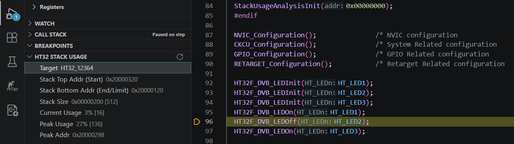


### 启用 Peak（watermark）跟踪

默认 **Peak Usage** 栏位显示提示信息。若需显示实际峰值：

1. 在 `ht32f5xxxx_conf.h`（或 `ht32f1xxxx_conf.h`）中将 `HTCFG_STACK_USAGE_ANALYSIS` 设为 `1`；49x 系列请在 conf.h 中手动添加此定义
2. 在启动时调用一次 `StackUsageAnalysisInit(0)`（RTOS scheduler 或主循环之前）

```c
#include "ht32_stack_analysis.h"

int main(void) {
    StackUsageAnalysisInit(0);   // 将未使用的堆栈空间填入特定 pattern，供峰值跟踪使用
    // ... 其余初始化
}
```

两个条件缺一不可；若未满足，**Peak Usage** 栏位会显示提示信息而非数值。

---

<br>

## 项目设置

点击工具栏的 **Settings** 打开设置面板，面板分为四个选项卡：

### Compiler 选项卡

| 设置项目 | 说明 |
|----------|------|
| Optimization | `-O0` / `-O1` / `-O2` / `-O3` / `-Os`（默认）/ `-Og` |
| Debug Info | `-g3`（默认，完整 debug）/ `-g`（标准）/ `-g1`（仅行号）/ `-g0`（无，release 用）|
| Float ABI | `soft`（M0/M3）/ `softfp` / `hard`（M4F） |
| FPU | `none` / `fpv4-sp-d16`（M4F）/ `fpv5-sp-d16`（M7）/ `fpv5-d16`（M7） |
| LTO | 启用 `-flto` |
| Include Paths | 所有 `-I` 搜索路径，写入 `includes.list`；转换时自动填入，可在此添加额外路径 |
| C Defines | 预处理器定义，写入 `defines.list`；转换时自动填入，可在此添加额外定义 |
| ASM Defines | 汇编器预处理器定义，写入 `adefines.list`；转换时自动填入，可在此添加额外定义 |
| Extra CFLAGS | 附加编译标志，例如 `-DDEBUG` |

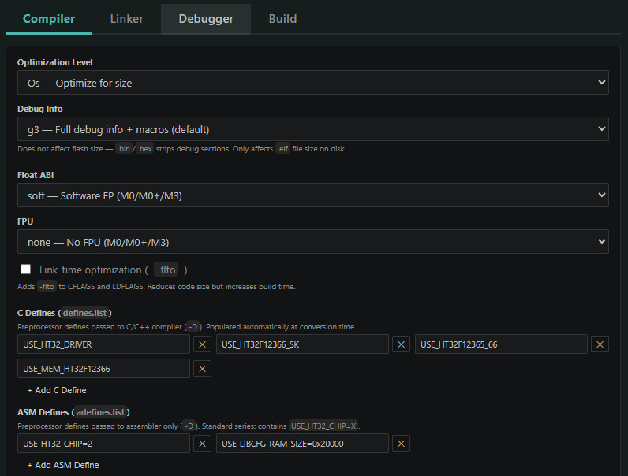
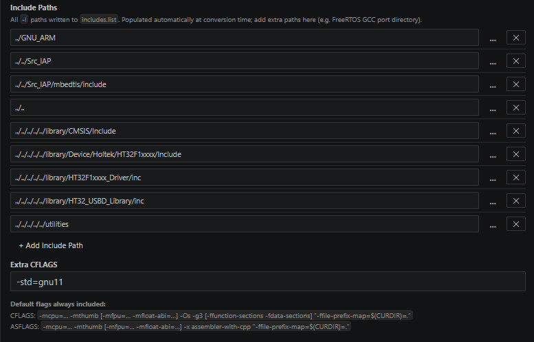

---

<br>

### Linker 选项卡

| 设置项目 | 说明 |
|----------|------|
| Dead Code Elimination | 启用 `-ffunction-sections -fdata-sections -Wl,--gc-sections`（默认开启）— 移除未使用的函数与数据 |
| C Runtime Library | `nano`（newlib-nano）/ `nosys`（不使用 syscalls）— 可同时勾选 |
| printf float | 启用浮点 printf（`-u _printf_float`） |
| scanf float | 启用浮点 scanf（`-u _scanf_float`） |
| Libraries (-l) | 要链接的库名称。输入名称时不需加 `lib` 前缀，例如输入 `MyDSP`，GCC 会在搜索路径中寻找 `libMyDSP.a`。若要直接加入预建 `.a` 文件（不通过搜索路径），请在工程视图的组上右键，选择**加入文件至组**。 |
| Search Paths (-L) | GCC 搜索库的目录（`-L"dir"`）。将含有 `.a` 文件的文件夹加入此处，再于上方 Libraries (-l) 填入对应的库名。 |
| Extra LDFLAGS | 直接传给链接器的附加标志。常见用途：`-Wl,--wrap=FunctionName`（拦截并替换特定函数）、`-Wl,--defsym=__heap_size=0x400`（覆盖链接器符号值）。完整选项请参考 [GNU ld manual](https://sourceware.org/binutils/docs/ld/)。 |
| Linker Scripts | 链接脚本路径（相对于 build 目录） |
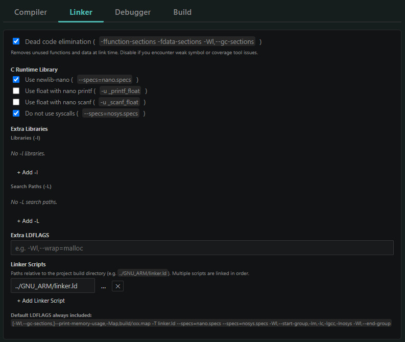

---

<br>

### Debugger 选项卡

| 设置项目 | 说明 |
|----------|------|
| **Debug Server** | **`PyOCD`**（默认）/ `OpenOCD` |
| Debug Interface | `CMSIS-DAP`（e-Link32）/ `J-Link` / `ST-Link` |
| Adapter Serial | 指定调试器序列号（空白 = 自动） |
| Adapter Speed | 传输速率 kHz（空白 = 接口默认） |
| Debug Level | 1~4 逐渐详细（默认 1）|
| DFP Path | 自定义 DFP 路径 |
| SVD File | 外设寄存器 SVD 文件（空白 = 自动检测） |
| Erase Mode | `erase_sector`（默认）/ `erase_chip` |
| Smart Flash | （仅 PyOCD）跳过未更改页面，加速重复烧录； |
| Flash Loaders | 附加外部 Flash Loader（例如 SPI Flash） |

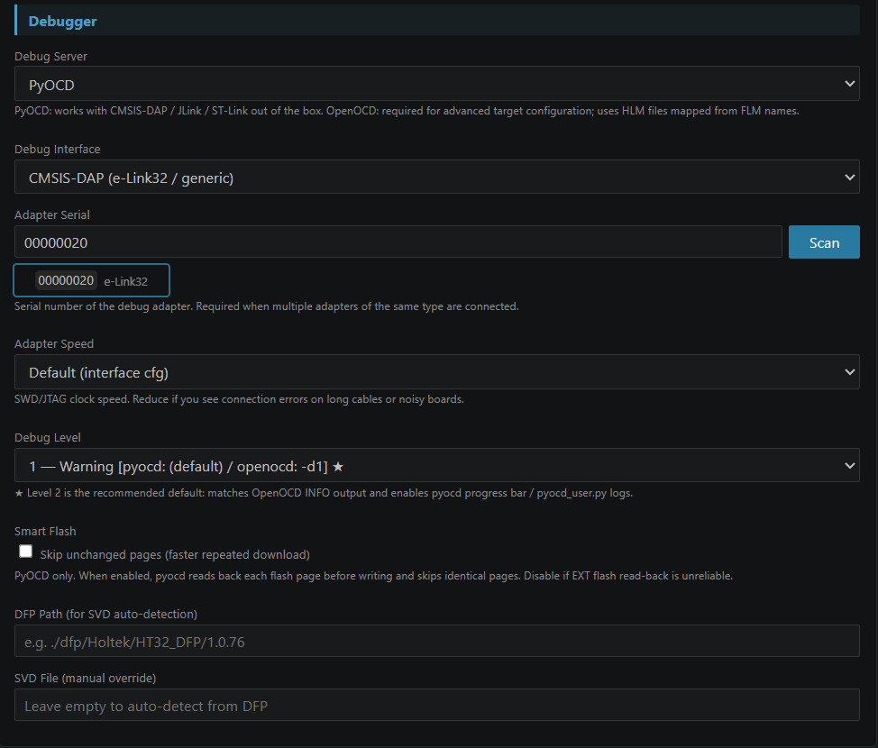
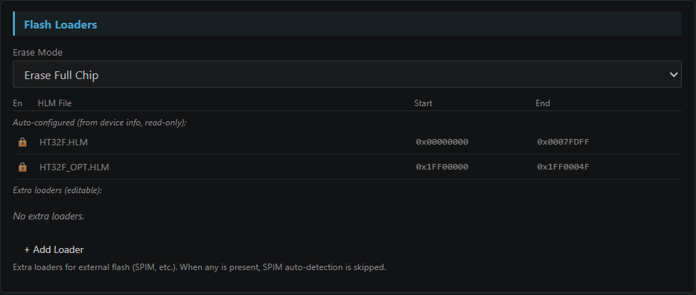

> 若使用 J-Link 搭配 OpenOCD，Windows 需将驱动更换为 WinUSB。切换后 SEGGER 工具（Keil、J-Flash 等）将无法识别 J-Link，还原方式为重新安装 SEGGER J-Link Software。搭配 pyOCD 则无需更换驱动。

---

<br>

### Build 选项卡

| 设置项目 | 说明 |
|----------|------|
| Output Filename | 自定义输出文件名（留空则沿用转换时的名称） |
| Post-Build | Build 后执行的命令（工作目录：`${workspaceFolder}` = `HT32_VSCode/`） |

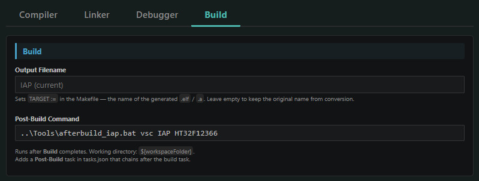

<br>

### Common 区块

显示于 Settings 面板下方，所有项目块之后。设置保存于 VS Code 机器设置（User Settings），所有项目共用。

| 设置项目 | 说明 |
|----------|------|
| Build Before Debug (F5) | 取消勾选后，F5 直接烧录并启动调试，不重新编译（默认：勾选） |
| GCC Path | `arm-none-eabi-gcc` 路径（空白 = 自动检测） |
| OpenOCD Path | OpenOCD 路径（空白 = 使用内置 OpenOCD） |

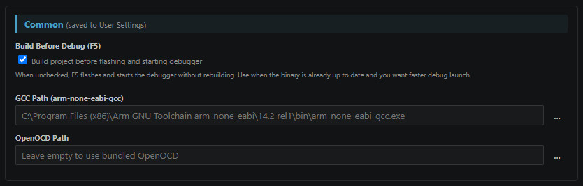

---

<br>

## 设置向导（Configuration Wizard）

**Holtek HT32 Configuration Wizard** 为依赖扩展，安装 Holtek HT32 VS Code Extension 时会自动一并安装，提供 HT32 固件配置文件的可视化图形编辑界面，兼容 Keil MDK Configuration Wizard 语法。

### 支持的配置文件

| 文件 | 用途 |
|------|------|
| `ht32fxxxx_conf.h` | Retarget（printf/scanf 输出端口、波特率、库启用） |
| `system_ht32fxxxx_NN.c` | 时钟设置（PLL、HSE/HSI、HCLK、WDT） |
| `ht32fxxxx_NN_usbdconf.h` | USB 端点设置 |
| `startup_ht32fxxxx_NN.s` | Stack / Heap 大小 |

### 打开方式

**方法一 — 编辑器标题按钮（推荐）：**  
打开支持的文件（`.h`、`.c`、`.s`）后，点击编辑器右上角的 **Open in Holtek Configuration Wizard** 按钮即可切换为 Wizard 视图；点击 **Reopen as source file** 切换回文字编辑。

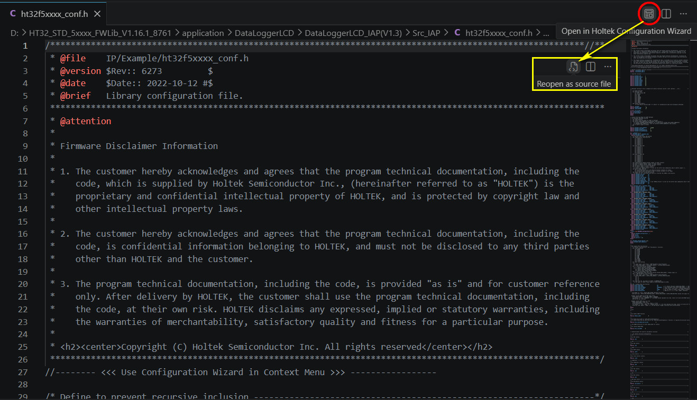

**方法二 — 右键菜单：**  
在左侧**文件管理器**面板中对 `.h`、`.c`、`.s` 文件右键 → **Open in Holtek Configuration Wizard**

**方法三 — 命令面板：**  
`Ctrl+Shift+P` → **HT32: Open in Holtek Configuration Wizard**

### 控件类型

| 类型 | 说明 |
|------|------|
| Checkbox（`<q>`） | 切换开关 |
| Dropdown（`<o>` 含选项） | 从预定义列表选择 |
| Number（`<o>` 含范围） | 在允许范围内输入数值 |
| Enable Section（`<e>`） | 主开关，控制整组设置的启用／停用 |
| Heading（`<h>`） | 可折叠组 |

---

<br>

## Code Intelligence（clangd）

导入或创建项目后，打开项目时自动为每个项目生成 `.clangd` 与独立的 `compile_commands.json`，提供完整的代码智能识别支持。多项目时，在项目树点选任意节点，`.clangd` 会自动切换至该项目的 `compile_commands.json`。

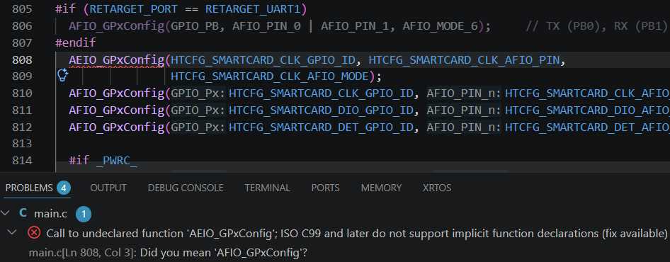
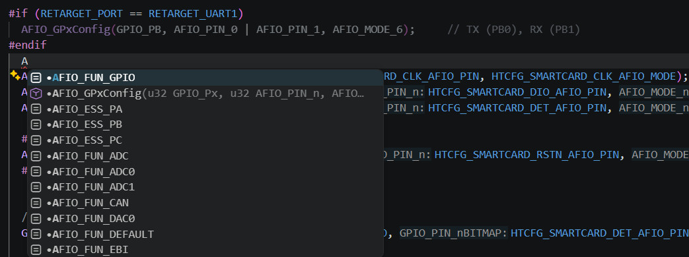


---

<br>

## 命令（Ctrl+Shift+P → "HT32"）

| 命令 | 说明 |
|------|------|
| `HT32: Create Project` | 打开创建项目向导 |
| `HT32: Open Project` | 浏览并打开 `.ht32vs` 项目文件 |
| `HT32: Convert uVision Project` | 导入 Keil `.uvprojx` / `.uvmpw` |
| `HT32: Convert HT32-IDE Projects` | 导入 Eclipse CDT `.project` |
| `HT32: Build` | 执行构建任务 |
| `HT32: Download` | 烧录固件 |
| `HT32: Erase Flash` | 清除整颗芯片的 Flash（chip erase） |
| `HT32: Debug` | 启动调试工作阶段 |
| `HT32: Clean` | 清除编译输出 |
| `HT32: Open Settings` | 打开项目设置 |
| `HT32: Generate Build & Debug Config` | 重新生成 `tasks.json` 与 `launch.json` |
| `HT32: Regenerate compile_commands.json` | 重新生成供 clangd 使用的 `compile_commands.json`；多项目工作区会显示 QuickPick，可选择单一项目或 **All Projects** |
| `HT32: Regenerate Makefile` | 从 `project.meta.json` 重新生成 `Makefile`；多项目工作区会显示 QuickPick，可选择单一项目或 **All Projects** |
| `HT32: Close Project` | 关闭当前加载的项目 |
| `HT32: Clear Recent Projects` | 清除最近打开列表 |
| `HT32: Refresh Stack Usage` | 手动刷新 Stack Usage Analysis 面板 |
| `HT32: Update Extension (Online)` | 从 VS Code Marketplace 检查新版本并自动安装 |
| `HT32: Install Extension from VSIX` | 打开文件选择器，安装本机 `.vsix` 包 |
| `HT32: Update Device Packs (Online)` | 从 Holtek 官网下载并安装缺少的 DFP packs |
| `HT32: Install Device Pack from File` | 打开文件选择器，安装一个或多个本机 `.pack` 文件 |

> **注意：** Device Pack 的用途是让 pyocd 识别原本不支持的 MCU 型号，只对使用 **pyocd** 的 debug 设置有效。若使用 OpenOCD，它有自己的内置脚本，安装 Pack 不会有任何影响。

---

<br>

## 第三方授权

内置与自动安装组件的授权信息请参阅 `THIRD_PARTY_LICENSES.md`。

---

<br>

## 授权

Proprietary — 请参阅 `LICENSE`
